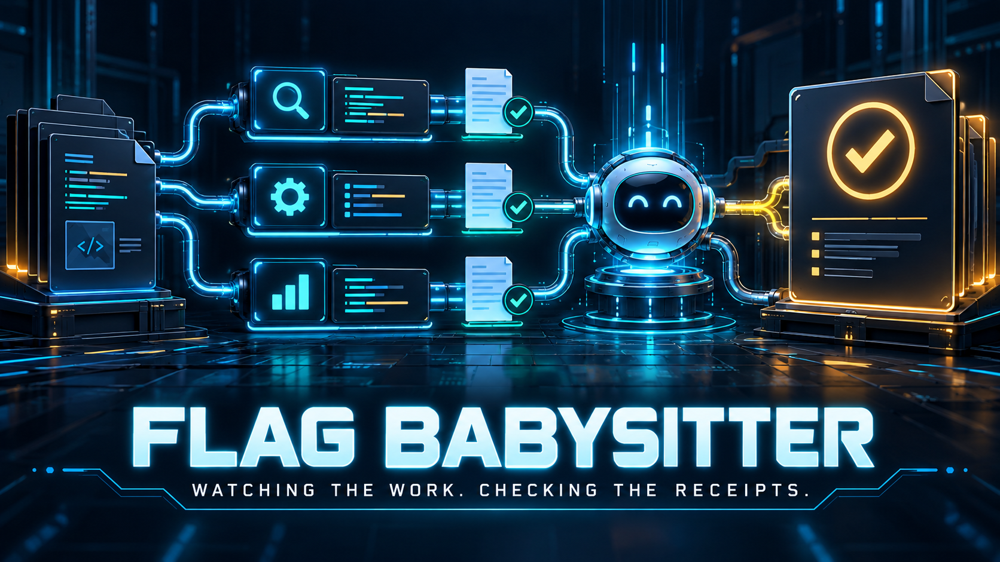
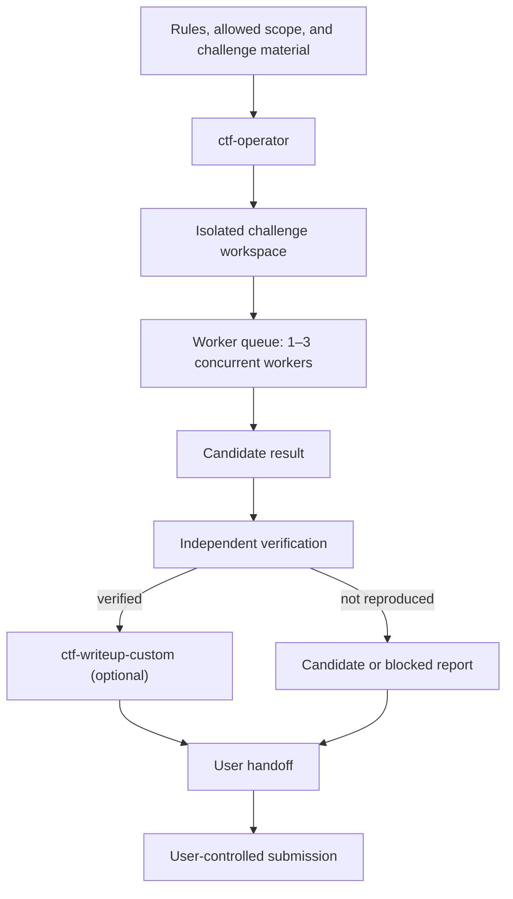
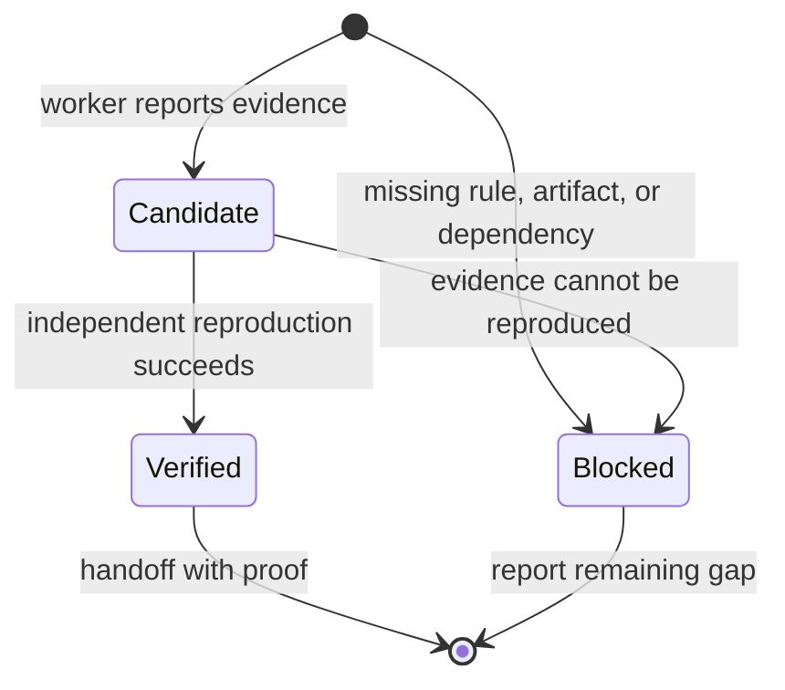
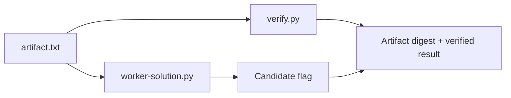

# Flag Babysitter



Evidence-driven Codex skills for coordinating authorized CTF work, documenting verified solves, and writing repository documentation without unsupported claims.

Flag Babysitter is a source repository for three skill directories. Its core workflow is designed to keep challenge work isolated, limit concurrent workers to three, distinguish candidate flags from independently verified results, and leave submission under user control. It also includes a small offline fixture that exercises the candidate-to-verification boundary without using a live event or real competition artifact.

This repository is currently a skill source tree, not an application or packaged plugin. It has no installer, release artifact, or declared software license yet.

## Contents

- [Why this repository exists](#why-this-repository-exists)
- [What is included](#what-is-included)
- [How the documented workflow fits together](#how-the-documented-workflow-fits-together)
- [Skills](#skills)
- [Requirements and installation status](#requirements-and-installation-status)
- [Quick verification](#quick-verification)
- [Example run configuration](#example-run-configuration)
- [Synthetic fixture](#synthetic-fixture)
- [Project structure](#project-structure)
- [Safety boundaries](#safety-boundaries)
- [Testing](#testing)
- [Current limitations](#current-limitations)
- [Contributing and license](#contributing-and-license)

## Why this repository exists

Multi-challenge CTF work can lose important boundaries when the workflow is informal: a worker may be given too much scope, a plausible flag may be treated as solved without reproduction, or a useful writeup may be produced before the underlying result is established.

The included skills document a narrower workflow for authorized CTF events, training labs, and supplied challenge bundles:

1. Establish the event rules, exact scope, workspace root, and submission policy.
2. Isolate each challenge in its own workspace.
3. Delegate no more than three independent challenges at once, or process them sequentially when subagents are unavailable.
4. Treat worker output as a candidate until a separate verification step reproduces it.
5. Produce a walkthrough only after verification.
6. Hand results to the user; submission is user-controlled by default.

The repository does not claim to solve every category of CTF challenge. It provides orchestration and documentation instructions around a solve process.

## What is included

| Component | Purpose | Evidence |
| --- | --- | --- |
| [`ctf-operator`](skills/ctf-operator/SKILL.md) | Coordinates an authorized CTF workflow, workspace isolation, worker limits, verification, and handoff. | [Skill entrypoint](skills/ctf-operator/SKILL.md) |
| [`ctf-writeup-custom`](skills/ctf-writeup-custom/SKILL.md) | Creates a detailed walkthrough from independently verified evidence. | [Skill entrypoint](skills/ctf-writeup-custom/SKILL.md) |
| [`evidence-readme`](skills/evidence-readme/SKILL.md) | Audits a repository before authoring a README and distinguishes verified facts from inference. | [Skill entrypoint](skills/evidence-readme/SKILL.md) |
| Hero banner | Original project artwork visualizing the documented analysis-to-verification workflow. | [PNG asset](assets/flag-babysitter-hero.png) |
| Synthetic fixture | Provides an offline candidate/verification example using only Python's standard library. | [Fixture](fixtures/synthetic-ctf/base64-proof/README.md) and [benchmark](benchmarks/synthetic-base64-proof.md) |
| Run configuration example | Documents the intended fields for an authorized run. It is not executable configuration. | [Example YAML](examples/run-config.yaml) |

## How the documented workflow fits together

The following flow is derived from the documented `ctf-operator` workflow and its optional handoff to `ctf-writeup-custom`.



The diagram is a workflow contract, not a claim that the repository runs an agent runtime itself. The skill text requires a single-agent queue when subagents are unavailable, so the same verification boundary remains in place without concurrent workers.

### Candidate versus verified

The distinction between these states is central to the repository:



`verified` means that a separate command, original artifact, scoped service, or supplied verifier reproduced the result. It does not mean a platform accepted a submitted flag; acceptance needs a separate platform response.


*Conceptual illustration of the documented candidate-to-verification boundary. The Mermaid state diagram and the fixture remain the authoritative workflow evidence.*

## Skills

### `ctf-operator`

[`skills/ctf-operator/SKILL.md`](skills/ctf-operator/SKILL.md) is the orchestration entrypoint. It requires an authorized event or lab, explicit scope, event rules, a workspace root, and a user-controlled submission policy. Its supporting references provide:

- a [run contract](skills/ctf-operator/references/run-contract.md) for the facts that must be established before work starts;
- a [worker task card](skills/ctf-operator/references/worker-task-card.md) that bounds each assignment and report;
- [portable environment guidance](skills/ctf-operator/references/environment.md) that avoids machine-specific paths;
- [category guidance](skills/ctf-operator/references/category-guidance.md) for routing without requiring external skill packs; and
- an [optional integration policy](skills/ctf-operator/references/integrations.md) for already-installed specialist skills.

The skill is written to remain useful without a third-party skill pack, a specific virtual environment, or a personal challenge template.

### `ctf-writeup-custom`

[`skills/ctf-writeup-custom/SKILL.md`](skills/ctf-writeup-custom/SKILL.md) is intentionally downstream of verification. It asks for evidence, solver paths, environment details, and publication constraints before writing.


*Conceptual illustration of the documentation handoff. It represents the writing contract; it does not depict a runtime component or a completed challenge.*

Its [style reference](skills/ctf-writeup-custom/references/style.md) supports:

- reasoning-led headings instead of a generic report outline;
- reproducible solver commands and dependency notes;
- Mermaid diagrams when they clarify a real flow or state;
- Markdown LaTeX for crypto derivations; and
- a final evidence/link/code check before handoff.

It does not submit flags, interact with a challenge service, or invent missing proof.

### `evidence-readme`

[`skills/evidence-readme/SKILL.md`](skills/evidence-readme/SKILL.md) is a separate documentation skill. Before editing a repository README, it requires a read-only audit covering source structure, entry points, tests, visible documentation, and safe metadata.

Its [audit template](skills/evidence-readme/references/audit-report.md) records verified facts, conservative inferences, and unavailable information. This README was authored under that contract.

## Requirements and installation status

No installer, package manifest, or release artifact is included in this repository. As a result, there is no repository-verified installation command to publish here yet.

The synthetic fixture test requires:

- Bash;
- Python 3; and
- standard-library modules `base64`, `hashlib`, `pathlib`, and `re`.

No third-party Python dependency is used by the fixture test. A future installation guide should be added only after the project provides and tests an installation mechanism for the intended Codex environment.

## Quick verification

Run the deterministic local fixture test from the repository root:

```bash
bash tests/validate-synthetic-fixture.sh
```

Expected success output:

```text
synthetic fixture: PASS
```

This command runs a worker-side solver and an independent verifier. It does not access a network service, use credentials, install dependencies, or submit anything.

## Example run configuration

[`examples/run-config.yaml`](examples/run-config.yaml) is an illustrative configuration document. The skills do not parse or execute it automatically.

```yaml
event:
  name: Example Training CTF
  workspace_root: ./workspace
scope:
  artifacts_only: true
  endpoints: []
workers:
  requested: 2 # valid range: 1-3
submission:
  mode: user-controlled
```

The documented fields are:

| Field | Meaning |
| --- | --- |
| `event.name` | Human-readable event or lab name. |
| `event.workspace_root` | Parent directory for isolated challenge workspaces. |
| `scope.artifacts_only` | Indicates an offline-only run in the example. |
| `scope.endpoints` | Explicit endpoint allowlist when remote targets are permitted. |
| `workers.requested` | Requested worker count; the operator contract limits it to 1–3. |
| `submission.mode` | Defaults to `user-controlled` in the example. |
| `writeup` | Documents whether to generate a writeup after verification and its output preferences. |
| `environment` | Documents optional activation commands; no path is assumed by the skills. |

## Synthetic fixture

The [Base64 Proof fixture](fixtures/synthetic-ctf/base64-proof/README.md) is a deliberately small offline challenge. It exists to demonstrate a single narrow guarantee: generating a candidate and verifying it are separate operations.



The verifier does not import the worker solver. It checks the original artifact's SHA-256 digest, independently decodes the payload, validates the synthetic flag format, and compares the deterministic expected result. The full scope, reproduction command, and limits are documented in the [synthetic benchmark](benchmarks/synthetic-base64-proof.md).

This fixture does not measure success on real events, network services, other challenge categories, or external subagents.

## Project structure

```text
.
├── assets/
│   ├── candidate-verification-concept.png # Candidate-to-verification illustration
│   ├── evidence-to-writeup-concept.png    # Evidence-to-writeup illustration
│   └── flag-babysitter-hero.png           # Original README hero artwork
├── benchmarks/
│   └── synthetic-base64-proof.md       # Evidence and limits of the fixture run
├── examples/
│   └── run-config.yaml                 # Illustrative run fields
├── fixtures/
│   └── synthetic-ctf/base64-proof/     # Offline artifact, solver, and verifier
├── skills/
│   ├── ctf-operator/                   # Authorized CTF orchestration skill
│   ├── ctf-writeup-custom/             # Verified-solve writeup skill
│   └── evidence-readme/                # Audit-first README authoring skill
├── tests/
│   └── validate-synthetic-fixture.sh   # Fixture test runner
└── PROJECT.md                           # Local project handoff; not public docs
```

## Safety boundaries

The skills document the following boundaries:

- operate only on supplied artifacts and explicitly allowed CTF/lab endpoints;
- keep credentials as user-controlled runtime secrets and exclude them from files, logs, and worker prompts;
- avoid probing unrelated infrastructure, account enumeration, rate-limit evasion, persistence, or real-world targets outside the event scope;
- prefer offline or read-only work and use bounded remote requests when an event allows them;
- keep submission under explicit user authorization; and
- distinguish local verification from platform acceptance.

These are documented workflow constraints, not a formal security audit or a guarantee that every dependent tool is secure.

## Testing

The repository currently documents one executable test:

```bash
bash tests/validate-synthetic-fixture.sh
```

It checks the expected worker candidate output, then checks independent verifier output and the expected artifact digest. The test was run while preparing this README and returned `synthetic fixture: PASS`.

No build, lint, coverage, integration-test, or end-to-end agent-runtime command is present in the repository at this time.

## Current limitations

- This is a source tree for skill instructions, not an installable package or standalone CTF application.
- No automatic installer has been implemented or verified.
- The only executable validation is one small offline synthetic fixture.
- No benchmark demonstrates performance on real CTF challenges, remote services, all categories, or agent runtimes.
- The example YAML is descriptive and is not parsed by code in this repository.
- There is no formal contribution workflow, issue tracker, changelog, or release process in the repository.
- `PROJECT.md` is an internal handoff document and needs a privacy/publication review before publishing the repository.

## Contributing and license

No contribution guide or license file is currently included. Do not assume reuse, redistribution, or contribution terms until the repository adds a license and documented contribution process.

For now, proposed changes should preserve the repository's central distinction between scoped work, candidate results, independently verified results, and user-controlled submission.
