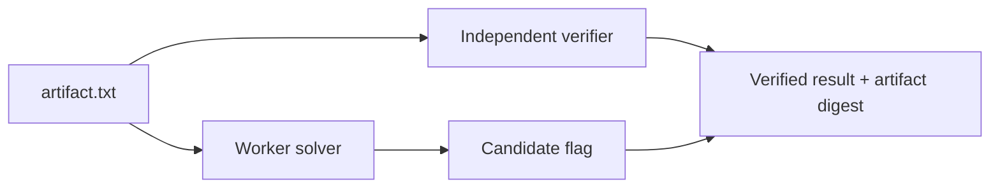

# Synthetic workflow benchmark

This benchmark demonstrates one narrow, deterministic path through the public `ctf-operator` contract. It does not represent a live event and does not establish performance across CTF categories.

## Run contract

| Field | Value |
| --- | --- |
| Event/lab | Synthetic local fixture |
| Scope | `fixtures/synthetic-ctf/base64-proof/artifact.txt` only |
| Category | Misc / encoding |
| Worker count | 1 |
| Submission mode | User-controlled; no submission exists |
| Remote access | None |

## Evidence flow



The worker solver decodes the artifact and emits a candidate. The verifier independently reads the original artifact, checks its SHA-256 digest, decodes it without importing the worker solver, validates the expected format, and compares the deterministic expected result.

## Reproduction

```bash
bash tests/validate-synthetic-fixture.sh
```

Expected success signal:

```text
synthetic fixture: PASS
```

## What this proves

- The fixture is offline and reproducible with Python's standard library.
- Candidate generation and verification use separate code paths.
- The verifier binds its result to the original artifact digest.
- The public worker/reporting model can distinguish a candidate from a verified result.

## What this does not prove

- Performance on real CTF challenges or every category.
- Correct behavior of an LLM or external subagent in every circumstance.
- Platform flag acceptance, network handling, or authorized submission behavior.
