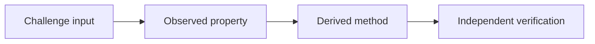

# Evidence-backed CTF writeup style

Write an elegant, complete walkthrough that a technical reader can audit and reproduce. The output should be useful on a Markdown-capable website without relying on private themes or local assets.

## Editorial rules

- Begin with a specific title. Include event/category context only when known and useful.
- Use short, descriptive headings that follow the actual reasoning. Do not force a fixed template.
- Separate observation from inference. Retain dead ends only when they explain a meaningful pivot.
- Use code fences with language identifiers. Include only commands that materially reproduce the solve.
- Use tables for compact comparison, not to replace explanation.
- Mention environment details only when they affect reproduction; never assume a machine-specific path.
- End at the final meaningful proof. Do not append a redundant conclusion.

## Mermaid

Use GitHub-compatible Mermaid fenced blocks only when they improve understanding:

Choose `flowchart` for data or exploit paths, `sequenceDiagram` for service/oracle exchanges, and `stateDiagram-v2` for demonstrated state machines. Keep labels short and explain non-obvious edges in prose. Do not use ASCII arrow diagrams or decorative diagrams.

## Crypto mathematics

Use `$...$` for inline mathematics and `$$...$$` for display equations. Define symbols near their first use, show the derivation that connects challenge parameters to the method, and explain each bound or assumption. Keep implementation near the mathematics it realizes.

## Final checks

Confirm that linked files exist, the saved solver matches documented code, Mermaid is fenced as `mermaid`, equations are syntactically plausible for the target renderer, and every result is supported by verified evidence.
